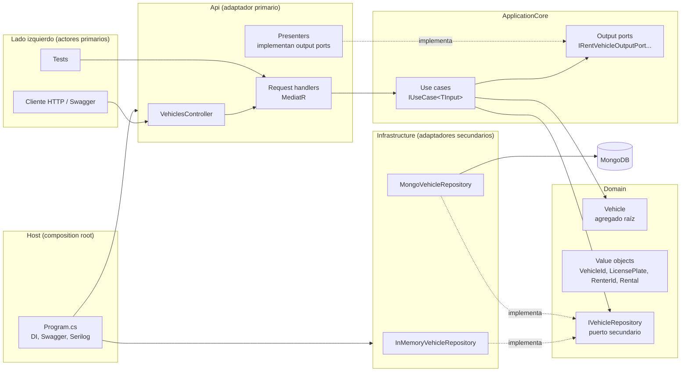
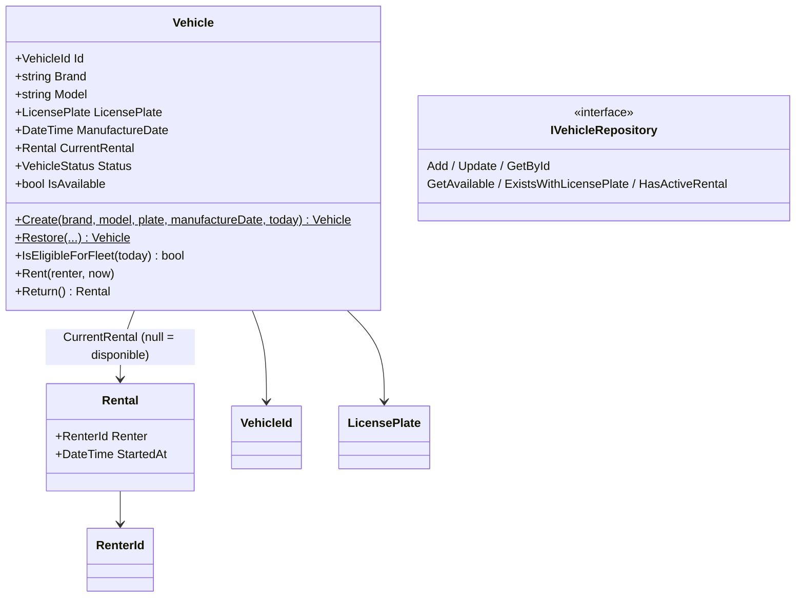
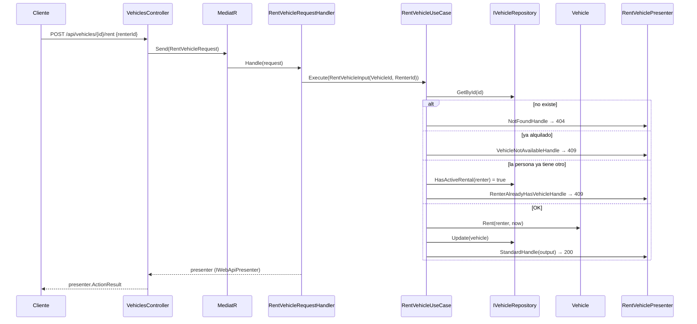

# Prueba técnica GT Motive / Capitole: microservicio de renting

Microservicio .NET 9 para gestionar la flota de una empresa de renting. Está construido sobre la plantilla de **arquitectura hexagonal** que proporcionaron (ver el [README](../README.md) original para la teoría).

## Índice
1. [Qué pide el enunciado y qué se ha hecho](#1-qué-pide-el-enunciado-y-qué-se-ha-hecho)
2. [Cómo ejecutarlo](#2-cómo-ejecutarlo)
3. [API REST](#3-api-rest)
4. [Arquitectura](#4-arquitectura)
5. [Dominio y reglas de negocio](#5-dominio-y-reglas-de-negocio)
6. [Recorrido de una petición](#6-recorrido-de-una-petición-alquilar-un-vehículo)
7. [Persistencia](#7-persistencia)
8. [Tests](#8-tests)
9. [Docker](#9-docker)
10. [Cambios sobre la plantilla original](#10-cambios-sobre-la-plantilla-original)
11. [Decisiones de diseño y posibles mejoras](#11-decisiones-de-diseño-y-posibles-mejoras)
12. [Mapa de archivos](#12-mapa-de-archivos)
13. [Preguntas típicas de la entrevista](#13-preguntas-típicas-de-la-entrevista)

---

## 1. Qué pide el enunciado y qué se ha hecho

| Requisito | Dónde está resuelto |
|---|---|
| Crear vehículos para la flota | `POST /api/vehicles` → `CreateVehicleUseCase` |
| Listar vehículos disponibles | `GET /api/vehicles/available` → `GetAvailableVehiclesUseCase` |
| Alquilar un vehículo | `POST /api/vehicles/{id}/rent` → `RentVehicleUseCase` |
| Devolver un vehículo | `POST /api/vehicles/{id}/return` → `ReturnVehicleUseCase` |
| Una persona no puede alquilar más de un vehículo a la vez | `RentVehicleUseCase` (consulta `HasActiveRental`), reforzado en persistencia (índice único en MongoDB / lock en memoria) |
| La flota no puede tener vehículos con más de 5 años | `Vehicle.Create` lanza `VehicleTooOldException`; el listado filtra los que hayan cumplido 5 años después del alta; no se pueden alquilar |
| Test de **infraestructura** (método REST a nivel de host) | `test/infrastructure/.../Specs/VehiclesControllerTests.cs` (TestServer + HTTP) |
| Test **unitario** (método sin dependencias) | `test/unit/...` (dominio, casos de uso con Moq, presenter, repositorio en memoria) |
| Test **funcional** (integración sin host) | `test/functional/.../Specs/VehicleRentalFunctionalTests.cs` (handlers de MediatR reales) |
| Ejecutable en local sin dependencias externas | Persistencia **en memoria** por defecto: basta con `dotnet run` |
| Dockerfile con imágenes oficiales `aspnet` / `sdk` | `src/GtMotive.Estimate.Microservice.Host/Dockerfile` |
| Docker como opción de inicio en Visual Studio | Perfil `Container (Dockerfile)` + proyecto `docker-compose.dcproj` |
| `.dockerignore`, puertos, variables y volúmenes | `.dockerignore`, `src/docker-compose.yml` (puerto 5080, variables `MongoDb__*`, volumen `mongo-data`) |
| Funcionar dentro y fuera del contenedor | Fuera: en memoria. Dentro (compose): MongoDB. Se elige por configuración |

---

## 2. Cómo ejecutarlo

**Requisito:** .NET SDK **9.0.100** (lo fija `global.json` con `rollForward: disable`). Docker solo hace falta para la opción con contenedores.

### Opción A: local, sin nada más (persistencia en memoria)
```bash
dotnet run --project src/GtMotive.Estimate.Microservice.Host --launch-profile http
```
Abre **http://localhost:5080/swagger**. Los datos se pierden al parar la aplicación.

### Opción B: Docker Compose (API + MongoDB)
Desde la raíz del repositorio:
```bash
docker compose -f src/docker-compose.yml up --build
```
- API / Swagger: **http://localhost:5080/swagger**
- MongoDB: `localhost:27017` (datos persistidos en el volumen `mongo-data`)
- En el log de arranque verás `Vehicle persistence: MongoDB`.

Para parar: `docker compose -f src/docker-compose.yml down` (añade `-v` para borrar también los datos).

### Opción C: solo la imagen de la API (en memoria)
```bash
docker build -f src/GtMotive.Estimate.Microservice.Host/Dockerfile -t gtmotive-fleet .
docker run --rm -p 5080:8080 -e ASPNETCORE_ENVIRONMENT=Development gtmotive-fleet
```

### Opción D: Visual Studio 2022
1. Abre `src/microservice.sln`.
2. Proyecto de inicio **GtMotive.Estimate.Microservice.Host** y en el desplegable de ejecución elige:
   - `http`: ejecución normal en local.
   - `Container (Dockerfile)`: ejecuta la API en un contenedor Linux (persistencia en memoria).
3. Para levantar **API + MongoDB** desde VS, marca **docker-compose** como proyecto de inicio.
   > El proyecto `docker-compose.dcproj` no está marcado para compilar en la configuración de la solución. Así `dotnet build`/`dotnet test` funcionan desde la CLI, que no tiene el SDK de Docker. Si VS lo pide, actívalo en *Build → Configuration Manager → docker-compose → Build*.
4. El archivo `GtMotive.Estimate.Microservice.Host.http` permite lanzar las peticiones de ejemplo desde el IDE.

### Tests
```bash
dotnet test src/microservice.sln
```
Resultado esperado: **55 tests** en verde (47 unitarios, 3 funcionales y 5 de infraestructura). Con cobertura:
```bash
dotnet test src/microservice.sln --settings test/coverlet.runsettings --collect "XPlat Code Coverage"
```

---

## 3. API REST

Las respuestas de error siguen **RFC 7807** (`ProblemDetails`).

| Método | Ruta | Body | Respuestas |
|---|---|---|---|
| `POST` | `/api/vehicles` | `{ "brand", "model", "licensePlate", "manufactureDate" }` | **201** creado · **400** validación / más de 5 años / fecha futura · **409** matrícula repetida |
| `GET` | `/api/vehicles/available` | – | **200** lista de vehículos disponibles |
| `POST` | `/api/vehicles/{id}/rent` | `{ "renterId": "12345678Z" }` | **200** alquilado · **400** vehículo con más de 5 años · **404** no existe · **409** ya alquilado, o la persona ya tiene otro |
| `POST` | `/api/vehicles/{id}/return` | – | **200** devuelto (con resumen del alquiler) · **404** no existe · **409** no estaba alquilado |

Ejemplo:
```bash
curl -X POST http://localhost:5080/api/vehicles -H "Content-Type: application/json" \
     -d '{"brand":"Seat","model":"Ibiza","licensePlate":"1234-ABC","manufactureDate":"2023-03-15"}'
```
```json
{ "id": "b7e5e04a-...", "brand": "Seat", "model": "Ibiza", "licensePlate": "1234ABC",
  "manufactureDate": "2023-03-15T00:00:00", "status": "Available", "rentedBy": null, "rentedAt": null }
```

Notas:
- La matrícula y el identificador del cliente se **normalizan** (mayúsculas, sin espacios ni guiones). Por eso `1234-abc` y `1234 ABC` son la misma matrícula.
- No hay autenticación en los endpoints de negocio. La plantilla deja configurada la autenticación de IdentityServer, pero los controladores no llevan `[Authorize]` para poder probarlos sin un servidor de identidad.

---

## 4. Arquitectura

Arquitectura hexagonal (puertos y adaptadores) con los proyectos de la plantilla:



**Regla de dependencias:** las flechas de compilación siempre apuntan hacia dentro.

| Proyecto | Responsabilidad | Depende de |
|---|---|---|
| `Domain` | Entidades, value objects, reglas e interfaces de repositorio. Sin frameworks. | – |
| `ApplicationCore` | Casos de uso (orquestan el dominio) y **output ports**. | Domain |
| `Infrastructure` | Adaptadores secundarios: repositorios (memoria, MongoDB), logging y telemetría. | ApplicationCore |
| `Api` | Adaptador primario: controlador, requests/handlers de MediatR, presenters y view models. | ApplicationCore, Infrastructure |
| `Host` | Punto de entrada: configuración, DI, Swagger, Serilog y selección de persistencia. | Api, Infrastructure |

**Patrones usados (los mismos que describe la plantilla):**
- **Controller + Command (MediatR):** el controlador solo hace `mediator.Send(request)`.
- **Use case / Application Service:** una clase por caso de uso; implementa `IUseCase<TInput>`.
- **Presenter + Output Port:** el caso de uso no devuelve nada; comunica el resultado llamando a métodos del *output port* (`StandardHandle`, `NotFoundHandle`, `RenterAlreadyHasVehicleHandle`...). El presenter implementa ese puerto y construye el `IActionResult`. Así la capa de aplicación no conoce HTTP.
- **Value Object, Entity / Aggregate Root, Repository** (DDD).
- **Object Mother** en los tests (`VehicleMother`).

---

## 5. Dominio y reglas de negocio

`src/GtMotive.Estimate.Microservice.Domain/Vehicles/`



- El **estado** se deriva de `CurrentRental`: si es `null`, el vehículo está `Available`; si no, `Rented`. Así no hay dos campos que puedan contradecirse.
- **Invariantes que protege el agregado:**
  - Marca y modelo obligatorios. La fecha de fabricación no puede ser futura.
  - `Create`: si la fecha de fabricación es anterior a *hoy - 5 años*, lanza `VehicleTooOldException`. Exactamente 5 años está permitido.
  - `Rent`: no se puede alquilar si ya está alquilado (`VehicleNotAvailableException`) ni si ya ha superado los 5 años.
  - `Return`: no se puede devolver si no está alquilado (`VehicleNotRentedException`).
- **"Una persona, un vehículo"** afecta a varios agregados, así que no puede comprobarlo un único `Vehicle`. Lo comprueba el caso de uso con `IVehicleRepository.HasActiveRental` y la persistencia lo garantiza ante concurrencia (ver §7).
- El dominio **no lee el reloj**: recibe `today`/`now` como parámetro. Los casos de uso usan `TimeProvider` (inyectado), lo que permite tests deterministas con `FixedTimeProvider`.
- Todas las excepciones de dominio heredan de `DomainException`. El `BusinessExceptionFilter` de la plantilla las convierte en **400**.

---

## 6. Recorrido de una petición (alquilar un vehículo)



Clave: el presenter es **scoped**, y se registra a la vez como su propio tipo (lo usa el handler) y como output port (lo usa el caso de uso). Así ambos comparten la misma instancia dentro de la petición. Está en `Api/DependencyInjection/UserInterfaceExtensions.cs`.

---

## 7. Persistencia

Puerto: `IVehicleRepository` (Domain). Hay dos adaptadores en `Infrastructure/Repositories`:

| Adaptador | Cuándo se usa | Notas |
|---|---|---|
| `InMemoryVehicleRepository` | Por defecto (`dotnet run`, tests, contenedor suelto) | Singleton. Guarda **copias inmutables**, así que los cambios no se ven hasta llamar a `Update`, igual que en una base de datos. Usa un `lock` para que la comprobación "una persona, un vehículo" sea atómica. |
| `MongoVehicleRepository` | Cuando `MongoDb:ConnectionString` empieza por `mongodb` (lo hace docker-compose) | Mapea a `VehicleDocument`, así el dominio no lleva atributos BSON. Crea índices únicos en `licensePlate` y un **índice único parcial** en `rentedBy` (solo existe en documentos alquilados). Con eso, dos peticiones concurrentes no pueden dar dos coches a la misma persona. El error de clave duplicada se traduce a la excepción de dominio. |

La selección está en `Host/Program.cs`:
```csharp
var infrastructure = builder.Services.AddBaseInfrastructure(builder.Environment.IsDevelopment()); // registra InMemory + TimeProvider
if (useMongoDb) infrastructure.AddMongoDbPersistence();                                               // lo sustituye por Mongo
```

Sobre `IUnitOfWork`: cada caso de uso modifica **un solo agregado**, y en MongoDB la escritura de un documento ya es atómica. Por eso no se ha registrado una unidad de trabajo artificial. Si un caso de uso tocase varios agregados, se añadiría una implementación con sesiones/transacciones de Mongo.

---

## 8. Tests

Los tres tipos de test que pide el enunciado, en los proyectos que trae la plantilla:

| Tipo (enunciado) | Proyecto | Qué hace | Ejemplos |
|---|---|---|---|
| **Unitario**: método sin dependencias | `test/unit` | Se prueba una clase aislada. Las dependencias se sustituyen por **Moq** o dobles (`FixedTimeProvider`). | `VehicleTests`, `ValueObjectsTests`, `RentVehicleUseCaseTests`, `CreateVehicleUseCaseTests`, `ReturnVehicleUseCaseTests`, `GetAvailableVehiclesUseCaseTests`, `RentVehiclePresenterTests`, `InMemoryVehicleRepositoryTests` |
| **Funcional**: integración sin host | `test/functional` | Usa el *composition root* real (`AddApiDependencies` + `AddBaseInfrastructure`) y llama a los **handlers de MediatR** directamente, sin servidor web. Prueba la integración handler → caso de uso → dominio → repositorio → presenter. | `Vehicle_CanBeCreatedRentedAndReturned`, `SamePerson_CanNotRentTwoVehiclesAtTheSameTime`, `VehicleOlderThanFiveYears_CanNotBeAddedToTheFleet` |
| **Infraestructura**: REST a nivel de host | `test/infrastructure` | Levanta la API en un **TestServer** en memoria y hace peticiones HTTP reales. Prueba routing, model binding, validación, filtros y serialización JSON. | `Post_WithValidVehicle_Returns201...`, `Post_WithVehicleOlderThanFiveYears_Returns400`, `Post_WithoutRequiredFields_Returns400`, `Rent_WhenPersonAlreadyHasAVehicle_Returns409`, `Return_WhenVehicleDoesNotExist_Returns404` |

Convención de nombres: `Metodo_Escenario_ResultadoEsperado`. Estructura AAA (Arrange, Act, Assert) con **FluentAssertions**.

---

## 9. Docker

**Dockerfile** (`src/GtMotive.Estimate.Microservice.Host/Dockerfile`), multi-stage:
1. `base` → `mcr.microsoft.com/dotnet/aspnet:9.0`, usuario no root (`$APP_UID`), puerto **8080**. Visual Studio usa esta etapa en *Fast mode*.
2. `build` → `mcr.microsoft.com/dotnet/sdk:9.0.100` (versión exacta porque `global.json` la exige). Primero copia la configuración común (`global.json`, `Directory.Build.*`, `.editorconfig`, `NuGet.config`) y los `.csproj` y hace `restore`, para aprovechar la caché de capas. Después copia el código y compila.
3. `publish` → `dotnet publish`.
4. `final` → copia solo lo publicado sobre `base`.

El **contexto de build es la raíz del repo**, porque hacen falta `global.json` y `Directory.Build.*`. En VS se indica con `<DockerfileContext>..\..</DockerfileContext>` en el `.csproj` del Host.

**docker-compose** (`src/docker-compose.yml`):
- `gtmotive.estimate.microservice.host`: puerto `5080:8080`. Variables `ASPNETCORE_ENVIRONMENT=Development`, `MongoDb__ConnectionString=mongodb://mongo:27017` y `MongoDb__MongoDbDatabaseName=fleet`. Espera a que Mongo esté *healthy*.
- `mongo`: `mongo:7.0`, volumen `mongo-data`, healthcheck con `mongosh`.

**.dockerignore** (raíz): excluye `bin/`, `obj/`, `.git`, `.vs`, tests, documentación, etc.

> Se usa `ASPNETCORE_ENVIRONMENT=Development` en el contenedor porque, en otros entornos, el `Program.cs` de la plantilla intenta conectarse a Azure Key Vault y Application Insights, que no existen en local.

---

## 10. Cambios sobre la plantilla original

La plantilla **no compilaba** tal como venía, porque tiene `TreatWarningsAsErrors` y las alertas de vulnerabilidades de NuGet se tratan como error. Se hicieron estos cambios mínimos:

| Cambio | Motivo |
|---|---|
| `MongoDB.Driver/Bson` 2.19 → 3.12 | Arrastraba `SharpCompress` y `Snappier` con vulnerabilidades (NU1902/NU1903). |
| `Microsoft.ApplicationInsights.Kubernetes` 7.0 → 8.0.1 | Arrastraba `KubernetesClient` vulnerable. |
| `Microsoft.Extensions.*` 9.0.0 → 9.0.2 | Evitar *downgrade* (NU1605) provocado por el cambio anterior. |
| `Newtonsoft.Json` 12 → 13.0.3 (referencia directa en Host) | Versión transitiva vulnerable. |
| Quitado `AutoMapper` del proyecto Api | No se usaba y tenía una vulnerabilidad. |
| `Microsoft.AspNetCore.TestHost` 6.0 → 9.0.2 | La versión 6 falla en .NET 9 (`PipeWriter.UnflushedBytes`). |
| Fixtures y clases base de tests: `internal` → `public` | xUnit exige clases de test públicas, que no pueden heredar de bases internas. |
| `test/.editorconfig` | Relaja reglas que no aplican a tests: CA1515, CA1707 (guiones bajos en nombres), CA2234 y SA1010. |
| Proyecto de unit tests: quitada la exclusión de la carpeta `Domain\**` | Para poder tener tests del dominio. |
| Dockerfile reescrito | El original no copiaba el proyecto `Domain` y dependía de un feed privado de Azure DevOps con un *Personal Access Token*. Además exponía el puerto 80, cuando .NET 8+ escucha en el 8080. |
| `launchSettings.json` añadido con `git add -f` | El `.gitignore` de la plantilla lo ignora, pero es necesario para el perfil Docker de Visual Studio. |

---

## 11. Decisiones de diseño y posibles mejoras

**Decisiones:**
- **Casos de uso sin valor de retorno + output ports:** es el patrón que propone la plantilla. Los flujos alternativos (404/409) van por el puerto. Los errores de validación del dominio salen como excepción y el filtro global los convierte en 400.
- **Value objects como `readonly record struct`:** dan igualdad por valor e inmutabilidad, y validan en el constructor.
- **`Vehicle.Restore`:** los repositorios reconstruyen el agregado sin pasar por las validaciones de alta. Por ejemplo, un coche dado de alta hace 4 años que hoy ya tiene 6 debe poder cargarse.
- **`TimeProvider`** (de la BCL de .NET 8+) en vez de `DateTime.UtcNow`: hace los tests deterministas sin depender de ningún paquete.
- **Persistencia en memoria por defecto:** cumple "ejecutable en local sin dependencias externas". MongoDB se activa solo con configuración, sin tocar código.

**Mejoras posibles:**
- Endpoint `GET /api/vehicles/{id}` y devolver `Location` en el 201.
- Historial de alquileres (entidad `Rental` persistida) en lugar de solo el alquiler activo.
- Autorización real (`[Authorize]` + políticas) usando el IdentityServer que ya configura la plantilla.
- Tests de integración del adaptador Mongo con **Testcontainers**.
- Health checks (`/health/live`, `/health/ready`). La configuración de Serilog de la plantilla ya los filtra.
- Pipeline de CI (GitHub Actions) con build, tests y cobertura.

---

## 12. Mapa de archivos

```
src/
├── GtMotive.Estimate.Microservice.Domain/Vehicles/
│   ├── Vehicle.cs                      ← agregado raíz y reglas
│   ├── VehicleId.cs, LicensePlate.cs, RenterId.cs, Rental.cs, VehicleStatus.cs
│   ├── IVehicleRepository.cs           ← puerto secundario
│   └── Exceptions/                     ← excepciones de dominio
├── GtMotive.Estimate.Microservice.ApplicationCore/
│   ├── ApplicationConfiguration.cs     ← registro de casos de uso
│   └── UseCases/Vehicles/{CreateVehicle,GetAvailableVehicles,RentVehicle,ReturnVehicle}/
│       ├── *Input.cs / *Output.cs      ← mensajes
│       ├── I*OutputPort.cs             ← puertos de salida
│       └── *UseCase.cs                 ← lógica de aplicación
├── GtMotive.Estimate.Microservice.Infrastructure/
│   ├── InfrastructureConfiguration.cs  ← AddBaseInfrastructure / AddMongoDbPersistence
│   └── Repositories/{InMemory,MongoDb}/
├── GtMotive.Estimate.Microservice.Api/
│   ├── Controllers/VehiclesController.cs
│   ├── DependencyInjection/UserInterfaceExtensions.cs ← registro de presenters
│   └── UseCases/Vehicles/*/            ← Request, RequestHandler, Presenter, Response
├── GtMotive.Estimate.Microservice.Host/
│   ├── Program.cs, Dockerfile, Properties/launchSettings.json
│   └── GtMotive.Estimate.Microservice.Host.http
├── docker-compose.yml / docker-compose.override.yml / docker-compose.dcproj
test/
├── unit/           ← Domain/, ApplicationCore/, Api/, Infrastructure/, TestDoubles/
├── functional/     ← Specs/VehicleRentalFunctionalTests.cs
└── infrastructure/ ← Specs/VehiclesControllerTests.cs
```

---

## 13. Preguntas típicas de la entrevista

**¿Por qué arquitectura hexagonal?**
Aísla la lógica de negocio de los detalles técnicos. Aquí se ve en la práctica: la misma lógica funciona con memoria o con MongoDB cambiando solo el adaptador, y se puede probar sin HTTP ni base de datos.

**¿Qué es un puerto y qué es un adaptador en este proyecto?**
- Puertos: `IVehicleRepository` (secundario) e `IUseCase<T>` / `I*OutputPort` (primarios).
- Adaptadores: `InMemoryVehicleRepository` y `MongoVehicleRepository` (secundarios), y el controlador con sus presenters (primarios).

**¿Dónde vive la regla de los 5 años? ¿Y la de una persona, un vehículo?**
- Los 5 años son un invariante del agregado `Vehicle`, porque solo depende de sus propios datos.
- "Una persona, un vehículo" afecta a varios agregados. La comprueba el caso de uso y la garantiza la persistencia (índice único parcial / lock).

**¿Qué pasa con dos peticiones simultáneas de la misma persona?**
Las dos podrían pasar el `HasActiveRental`. Pero en Mongo el índice único parcial sobre `rentedBy` hace fallar la segunda escritura. El repositorio traduce ese error a `RenterAlreadyHasVehicleException` y el caso de uso responde 409.

**¿Por qué los casos de uso no devuelven nada?**
Para seguir el patrón *Presenter*: el caso de uso habla con un puerto de salida con métodos con significado de negocio (`RenterAlreadyHasVehicleHandle`). La traducción a HTTP es responsabilidad de la capa Api.

**¿Cómo se prueba sin depender de la fecha actual?**
Con `TimeProvider`. En los tests se inyecta `FixedTimeProvider`.

**Diferencia entre test funcional y de infraestructura aquí:**
- El funcional entra por MediatR, sin web: prueba la composición de la aplicación.
- El de infraestructura entra por HTTP con TestServer: prueba también routing, validación, filtros y JSON.
